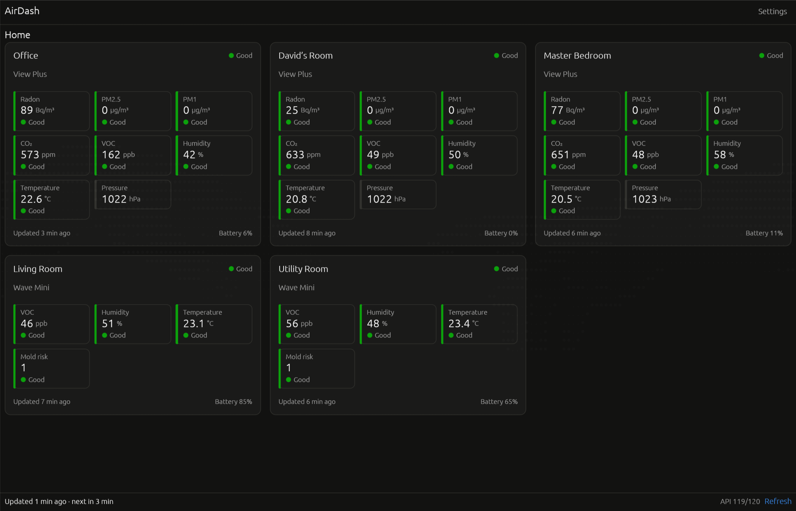

# AirDash



A cross-platform desktop dashboard for Airthings air quality monitors. It replaces the retiring
[Airthings Web Dashboard](https://dashboard.airthings.com/).

Written in Rust with [egui](https://github.com/emilk/egui). There is no server: the app talks directly to the
[Airthings Consumer API](https://consumer-api-doc.airthings.com/) from your computer.

> AirDash is an independent project and is not affiliated with or endorsed by Airthings.

## Features

- Every device on your account, grouped by home, with live sensor values (radon, CO₂, VOC, PM, humidity,
  temperature, pressure and more). Each value is rated Good, Fair or Poor using Airthings' thresholds.
- Drag device cards to put them in the order you like.
- Refreshes every 5 minutes while open, or right away with Refresh in the status bar.
- Starts instantly: the last known readings, device order and window size are restored at launch.
- Metric or imperial units, plus light, dark or system theme.
- Credentials are stored in the OS keychain (Windows Credential Manager, macOS Keychain, Secret Service on Linux).

AirDash only shows the latest reading of each device and keeps no history. The dashboard is saved to
`state.json` in the app's data folder after every refresh and every rearrangement, so the next launch shows it
at once and refreshes only when it is more than 5 minutes old.

## Installing

### Linux (including Omarchy) and macOS

```bash
curl -fsSL https://christianhelle.com/airdash/install | bash
```

The script downloads the latest release for your CPU (x64 or ARM64) and installs `airdash` to `~/.local/bin`.
On Linux it also adds AirDash to your app launcher, so on Omarchy you can start it with Super + Space and
typing "AirDash". Run the same command again to update.

Options are passed after `bash -s --`:

```bash
# Install a specific release
curl -fsSL https://christianhelle.com/airdash/install | bash -s -- --version v0.1.0

# Install somewhere else than ~/.local/bin
curl -fsSL https://christianhelle.com/airdash/install | bash -s -- --dir /usr/local/bin

# Remove AirDash, its launcher entry and its icon (settings and saved readings are kept)
curl -fsSL https://christianhelle.com/airdash/install | bash -s -- --uninstall
```

The Linux builds need glibc 2.35 or newer (Ubuntu 22.04, Debian 12, Fedora 36, any current Arch or Omarchy).

### Windows

Download `airdash-x86_64-pc-windows-msvc.zip`, or `airdash-aarch64-pc-windows-msvc.zip` for ARM64, from
[GitHub Releases](https://github.com/christianhelle/airdash/releases/latest), extract it and run `airdash.exe`.

### From crates.io

With [Rust](https://rustup.rs) installed (see the Linux prerequisites under [Development](#development)):

```bash
cargo install airdash
```

This installs only the binary, to `~/.cargo/bin`. To add it to a Linux app launcher, copy
`src/airdash/assets/com.christianhelle.airdash.desktop` to `~/.local/share/applications/` and
`src/airdash/assets/icon.png` to `~/.local/share/icons/hicolor/256x256/apps/com.christianhelle.airdash.png`.

### Manually from a release archive

The Linux archives contain the `airdash` binary, a desktop entry and an icon. This is what the install script
does:

```bash
tar -xzf airdash-x86_64-unknown-linux-gnu.tar.gz
install -Dm755 airdash ~/.local/bin/airdash
install -Dm644 com.christianhelle.airdash.desktop ~/.local/share/applications/com.christianhelle.airdash.desktop
install -Dm644 com.christianhelle.airdash.png ~/.local/share/icons/hicolor/256x256/apps/com.christianhelle.airdash.png
```

## Signing in

AirDash has no Airthings credentials built in. Each user signs in with their own account's API client, so
everyone sees only their own devices:

1. Create an API client under [Airthings My Applications](https://consumer-api-doc.airthings.com/dashboard).
2. Start AirDash and paste the client ID and secret into the sign-in screen. You only need to do this once:
   they are kept in the OS keychain.

### Browser sign-in with an OAuth client

If you have an Airthings OAuth client that uses the authorization code flow (only *business* accounts can
create these), enter it under Settings → Advanced sign-in options and register the redirect URI shown there
(`http://127.0.0.1:53682/callback` by default). After signing out, the sign-in screen then offers "Sign in with
Airthings", which opens the Airthings login page in your browser.

## Development

Prerequisites: [Rust](https://rustup.rs). On Linux, also `pkg-config`, `libdbus-1-dev` and `libxkbcommon-dev`.

```bash
cargo run
cargo test --workspace
cargo clippy --workspace --all-targets
cargo build --release
```

Release builds for Windows, macOS and Linux are attached to a draft GitHub release when a `v*` tag is pushed.

### Layout

| Path | What |
| --- | --- |
| `src/airdash/src/backend.rs` | Starts the core services and hands background results to the UI |
| `src/airdash/src/views/` | Sign-in, dashboard, settings and status bar |
| `src/airdash/src/widgets.rs` | Cards, level badges and sensor tiles |
| `src/airdash/src/sensors.rs` | Sensor labels, units, conversions and air-quality levels |
| `src/airdash/src/single_instance.rs` | The single running instance |
| `src/airthings-client/src/api.rs` | Typed Consumer API client |
| `src/airthings-client/src/auth.rs` | OAuth (PKCE and loopback redirect) and client-credentials token requests |
| `src/airthings-client/src/session.rs` | Access-token caching, refresh, the retry on 401 and the browser sign-in flow |
| `src/airthings-client/src/store.rs` | Where a session keeps its credentials, with an in-memory store |
| `src/airdash-core/src/secrets.rs` | Keychain credential storage |
| `src/airdash-core/src/refresh.rs` | Fetching the devices and their latest readings |
| `src/airdash-core/src/state.rs` | The saved dashboard state and device order |

## License

MIT
